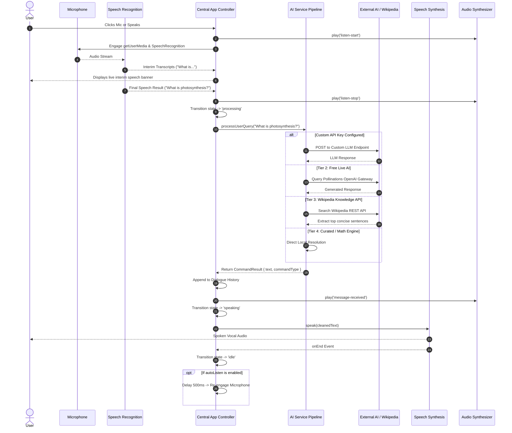
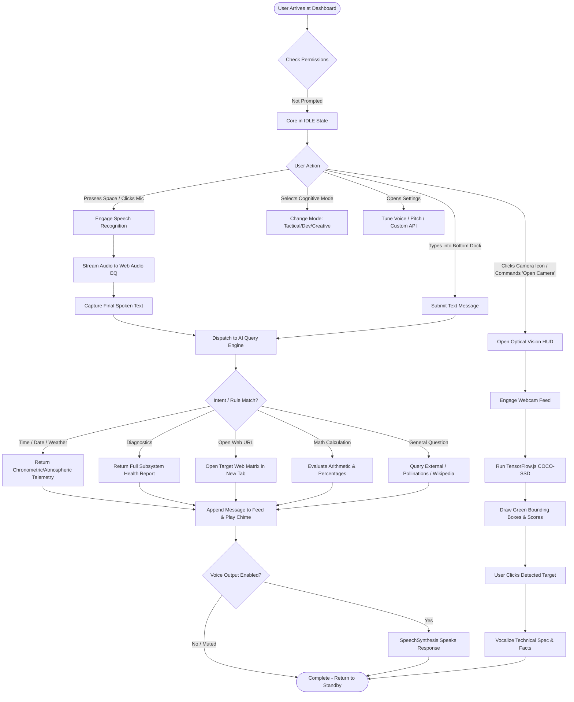
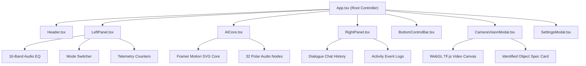
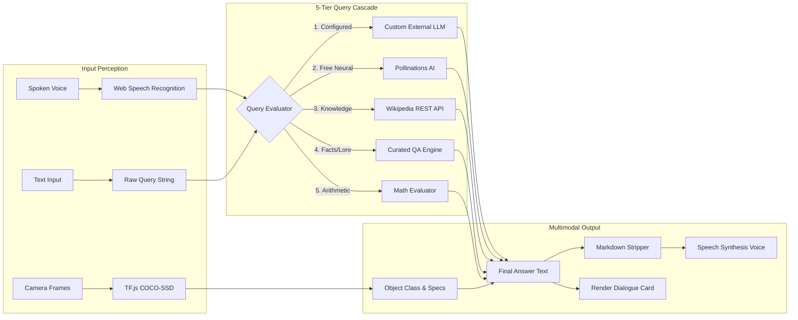

# MAYA — Multimodal Autonomous Yield Architecture (LP-AI)

<div align="center">

```
   ███╗   ███╗ █████╗ ██╗   ██╗ █████╗ 
   ████╗ ████║██╔══██╗╚██╗ ██╔╝██╔══██╗
   ██╔████╔██║███████║ ╚████╔╝ ███████║
   ██║╚██╔╝██║██╔══██║  ╚██╔╝  ██╔══██║
   ██║ ╚═╝ ██║██║  ██║   ██║   ██║  ██║
   ╚═╝     ╚═╝╚═╝  ╚═╝   ╚═╝   ╚═╝  ╚═╝
   MULTIMODAL AUTONOMOUS YIELD ARCHITECTURE
```

**Next-Generation Cybernetic AI Voice & Vision Assistant Dashboard**

[](https://react.dev/)
[](https://www.typescriptlang.org/)
[](https://vite.dev/)
[](https://tailwindcss.com/)
[](https://www.tensorflow.org/js)
[](https://www.framer.com/motion/)
[](https://github.com/bellagantilakshmiprasad225-a11y/LP-AI)
[](https://opensource.org/licenses/MIT)

[Live Demo](#screenshots--interface-walkthrough) • [Key Features](#8-key-features) • [System Architecture](#13-complete-system-architecture) • [Getting Started](#30-development-prerequisites) • [Deployment](#37-deployment-guide)

</div>

---

## Table of Contents

1. [Project Title](#1-project-title)
2. [Project Logo & Visual Identity](#2-project-logo--visual-identity)
3. [Badges & Technology Metrics](#3-badges--technology-metrics)
4. [Table of Contents](#table-of-contents)
5. [Project Overview](#5-project-overview)
6. [Problem Statement](#6-problem-statement)
7. [Vision & Objectives](#7-vision--objectives)
8. [Key Features](#8-key-features)
9. [Target Users](#9-target-users)
10. [Use Cases](#10-use-cases)
11. [Business Value](#11-business-value)
12. [Screenshots & Interface Walkthrough](#12-screenshots--interface-walkthrough)
13. [Complete System Architecture](#13-complete-system-architecture)
14. [High-Level Architecture Overview](#14-high-level-architecture-overview)
15. [Application Workflow](#15-application-workflow)
16. [End-to-End User Flow](#16-end-to-end-user-flow)
17. [Technology Stack](#17-technology-stack)
18. [Project Folder Structure](#18-project-folder-structure)
19. [Explanation of Every Major Folder](#19-explanation-of-every-major-folder)
20. [Explanation of Every Important File](#20-explanation-of-every-important-file)
21. [Frontend Architecture](#21-frontend-architecture)
22. [Backend Architecture](#22-backend-architecture)
23. [Database Architecture](#23-database-architecture)
24. [API Overview](#24-api-overview)
25. [Authentication & Authorization](#25-authentication--authorization)
26. [State Management](#26-state-management)
27. [Storage Strategy](#27-storage-strategy)
28. [Third-Party Services & Integrations](#28-third-party-services--integrations)
29. [AI & Automation Components](#29-ai--automation-components)
30. [Development Prerequisites](#30-development-prerequisites)
31. [Installation Guide](#31-installation-guide)
32. [Environment Variables (`.env`) Documentation](#32-environment-variables-env-documentation)
33. [Project Configuration](#33-project-configuration)
34. [Running the Project (Development)](#34-running-the-project-development)
35. [Running the Project (Production)](#35-running-the-project-production)
36. [Build Process](#36-build-process)
37. [Deployment Guide](#37-deployment-guide)
38. [CI/CD Overview](#38-cicd-overview)
39. [Testing Strategy](#39-testing-strategy)
40. [Debugging Tips](#40-debugging-tips)
41. [Logging & Monitoring](#41-logging--monitoring)
42. [Security Considerations](#42-security-considerations)
43. [Performance Optimizations](#43-performance-optimizations)
44. [Coding Standards & Project Conventions](#44-coding-standards--project-conventions)
45. [Versioning Strategy](#45-versioning-strategy)
46. [Branching Strategy](#46-branching-strategy)
47. [Contribution Guidelines](#47-contribution-guidelines)
48. [Release Process](#48-release-process)
49. [Known Limitations](#49-known-limitations)
50. [Future Roadmap](#50-future-roadmap)
51. [Frequently Asked Questions (FAQ)](#51-frequently-asked-questions-faq)
52. [Troubleshooting Guide](#52-troubleshooting-guide)
53. [Changelog](#53-changelog)
54. [License](#54-license)
55. [Credits & Acknowledgements](#55-credits--acknowledgements)
56. [Contact Information](#56-contact-information)
57. [Final Project Summary](#57-final-project-summary)

---

## 1. Project Title

**MAYA (Multimodal Autonomous Yield Architecture)** — Internal Project Code: **LP-AI**.

MAYA is an enterprise-grade, browser-native cybernetic AI assistant designed with a futuristic heads-up display (HUD) paradigm. It delivers continuous bidirectional voice conversations, real-time edge computer vision object recognition, dynamic audio spectrum telemetry, and multi-tier cognitive intelligence.

---

## 2. Project Logo & Visual Identity

```
                 ▲
               ◄ ● ►       M A Y A
                 ▼     [ SYSTEM ACTIVE ]
        ┌───────────────────────────────┐
        │ 01001100 01010000 00101101 01 │
        │ N E U R A L   M A T R I X    │
        └───────────────────────────────┘
```

The visual identity of MAYA revolves around a cyberpunk holographic aesthetic:
- **Primary Color:** Electric Cyan (`#00f0ff`)
- **Secondary Accent:** Sky Blue (`#0ea5e9`) / Indigo Blue (`#1e1b4b`)
- **Deep Canvas:** Abyssal Void (`#030712`)
- **HUD Glass:** High-blur backdrop-filtered acrylic cards with luminous neon edge borders.
- **Typography:** Orbitron (Display / Headers), Rajdhani (Telemetry / HUD Labels), JetBrains Mono (Code & Diagnostics), and Inter (Dialogue Body).

---

## 3. Badges & Technology Metrics

| Metric | Badge / Specification |
| :--- | :--- |
| **Framework** |  |
| **Language** |  |
| **Bundler** |  |
| **Styling** |  |
| **Edge AI** |  |
| **Object Detection** | `coco-ssd` v2.2.3 (MobileNet v2 Backbone) |
| **Motion Physics** | Framer Motion v14.3.0 |
| **Icons** | Lucide React v1.59.0 |
| **Linting** | Oxlint v1.81.0 (Rust-based hyper-fast linter) |
| **Code Style** | Strict TypeScript + Zero Ad-Hoc Utilities |

---

## 5. Project Overview

MAYA (**Multimodal Autonomous Yield Architecture**) redefines the web conversational interface. Moving beyond conventional, flat chatbot text boxes, MAYA creates an immersive, ambient digital command bridge. 

The application runs directly inside modern web browsers with **zero mandatory server dependencies** for its core operations:
1. **Perception Layer:** Continuous real-time voice capture via the Web Speech API and an interactive Web Audio API frequency spectrum analyzer.
2. **Vision Layer:** Real-time client-side object detection powered by TensorFlow.js and COCO-SSD running directly on WebGL/WebGPU shaders.
3. **Cognitive Layer:** A resilient 5-tier query engine that cascades from custom external LLMs down to free neural generators, live encyclopedic knowledge lookups, curated reasoning, natural language math evaluation, and cybernetic system commands.
4. **Vocal Synthesis Layer:** Natural human speech generation via the Web Speech Synthesis API with auto-markdown stripping, voice pitch/rate tuning, and continuous conversation looping.
5. **Aesthetic Audio Layer:** An embedded procedural Web Audio API synthesizer that produces sci-fi UI soundscapes without requiring any audio assets to be downloaded over the network.

---

## 6. Problem Statement

Most modern web AI user interfaces face critical shortcomings:
- **Static, Uninspired Design:** Monotonous text boxes with scrolling bubbles provide minimal situational awareness, audio telemetry, or tactile feedback.
- **Heavy Cloud Dependence for Vision:** Computer vision typically requires streaming video frames over HTTP/WebSockets to expensive remote GPU servers, inducing latency, ballooning infrastructure costs, and raising privacy concerns.
- **Voice Lag & Fragmentation:** Voice interactions are often implemented as disjointed record-and-stop widgets without continuous feedback, interim transcripts, or reactive animation states.
- **Rigid Single-Provider Vendor Lock-In:** Typical apps fail completely if an API key expires, an external model rate-limits, or internet connectivity falters.

MAYA resolves these problems by providing an entirely client-orchestrated, multi-tiered architecture that runs perception locally on device hardware, combines local and remote intelligence, and presents a responsive visual HUD.

---

## 7. Vision & Objectives

- **Frictionless Multimodal Intelligence:** Deliver voice, text, and computer vision recognition instantaneously in standard browsers without complex driver or runtime installations.
- **Client-Side Privacy & Sovereign Compute:** Execute computer vision inference locally on the user's hardware via WebGL shaders, ensuring camera frames never leave the device.
- **Aesthetic Excellence:** Transform the user interaction into a sci-fi command experience with glassmorphism, glowing telemetry, and real-time audio reactivity.
- **Zero-Barrier Accessibility:** Ensure hands-free operation for users with physical impairments through continuous voice synthesis, speech recognition, and keyboard navigation.

---

## 8. Key Features

```
┌────────────────────────────────────────────────────────────────────────┐
│                        MAYA CORE FEATURE MATRIX                        │
├───────────────────────┬───────────────────────┬────────────────────────┤
│ 🎙️ Continuous Voice   │ 👁️ Edge Neural Vision │ ⚡ Dynamic AI Core    │
│ • SpeechRecognition   │ • COCO-SSD MobileNet  │ • Framer Motion Canvas │
│ • Interim Transcript  │ • 90 Object Classes   │ • 4 Reactive States    │
│ • Auto-Loop Listen    │ • Local Inference     │ • Polar EQ Orbiters    │
├───────────────────────┼───────────────────────┼────────────────────────┤
│ 🧠 5-Stage Cascade    │ 🎛️ Cybernetic HUD     │ 🔊 Procedural Audio    │
│ • Custom LLM Gateway  │ • 16-Band Audio EQ    │ • Zero-Asset Web Audio │
│ • Pollinations Engine │ • System Telemetry    │ • Dynamic Freq Ramps   │
│ • Wikipedia Knowledge │ • 4 Cognitive Modes   │ • Tonal User Feedback  │
└───────────────────────┴───────────────────────┴────────────────────────┘
```

### 1. Continuous Speech Recognition Matrix
- Built upon browser `webkitSpeechRecognition` and `SpeechRecognition` engines.
- Real-time interim transcript display informs the user what is being processed mid-sentence.
- Configurable `autoListen` mode automatically re-engages the microphone after MAYA finishes speaking.

### 2. Edge Neural Vision HUD
- Local inference using `@tensorflow-models/coco-ssd` with `lite_mobilenet_v2`.
- Real-time canvas overlay rendering precise bounding boxes, class names, and confidence percentages.
- Supports live webcam streaming, mobile camera switching (`user` vs. `environment`), freeze-frame capture, and local image file uploads.
- Built-in technical encyclopedia providing classification summaries, hardware specs, and historical trivia for detected objects.

### 3. Holographic AI Core
- Powered by Framer Motion with rotating concentric cybernetic rings, pulsing geometric accents, and dynamic glow shaders.
- Core visually transitions through four operational states:
  - `idle`: Subdued cyan pulse, standby scanning ring.
  - `listening`: High-velocity emerald rotation with audio level amplitude scaling.
  - `processing`: Amber synapse calculation animation.
  - `speaking`: Harmonic cyan vocal transmission modulation.
- 32-node polar audio visualizer plotted mathematically around the perimeter.

### 4. Resilient 5-Stage Query Cascade
- **Tier 1:** Custom External LLM Bridge (OpenAI, Groq, Ollama, OpenRouter).
- **Tier 2:** Live Generative AI Bridge (Pollinations OpenAI engine with mode-specific system prompts).
- **Tier 3:** Live Encyclopedic Knowledge Matrix via Wikipedia REST API search and summary extraction.
- **Tier 4:** Curated Zero-Latency Knowledge Base covering geography, science, computing, and common facts.
- **Tier 5:** Natural Language Math Evaluator (evaluates percentages, square roots, and natural math expressions without dangerous arbitrary `eval`).

### 5. Cybernetic Audio Synthesizer
- Generates bespoke sci-fi audio cues entirely through code using `OscillatorNode` and `GainNode`.
- Sounds for button clicks, voice stream activation, microphone shutoff, message dispatch, response receipt, mode transition, and system warnings.
- 100% asset-free; zero audio files required over the network.

### 6. System Telemetry & Activity Monitoring
- Live HUD displaying simulated neural synaptic load, memory allocation, round-trip latency, core thermal index, session duration, and query count.
- Dual-tab right panel featuring continuous dialogue chat and a timestamped system activity log.

---

## 9. Target Users

- **Developers & Systems Engineers:** Requiring an intelligent voice-driven terminal dashboard for rapid lookups, code snippets, and system workflows.
- **Accessibility Seekers:** Individuals with visual or motor impairments who benefit from hands-free speech input, voice readout, and object recognition.
- **Students & Researchers:** Exploring modern client-side machine learning, computer vision, and browser audio engineering.
- **Creative Technologists & UI Designers:** Seeking inspiration for futuristic, high-engagement cybernetic web design.

---

## 10. Use Cases

1. **Hands-Free Developer Workspace:** Ask for Python/TypeScript syntax, regex patterns, or architectural best practices without switching browser windows or taking hands off the keyboard.
2. **Visual Inspection & Object Identification:** Point a smartphone or laptop camera at physical components (cables, keyboards, books, bottles) to receive an instant spoken classification and technical breakdown.
3. **Voice-Navigated Web Launcher:** Issue commands like `"Open GitHub"`, `"Search Google for quantum computing"`, or `"Launch YouTube"` to trigger automated navigation.
4. **Instant Calculation & Conversion:** Speak natural math queries like `"What is 18% of 240?"` or `"Calculate square root of 1024"` to get instant computed answers.
5. **System Diagnostics & Ambient Status:** Monitor simulated system telemetry and network response metrics in an ambient HUD during working sessions.

---

## 11. Business Value

- **Zero Baseline Server Cost:** By orchestrating speech recognition, vocal synthesis, computer vision, and client-side logic in the browser, compute costs are eliminated for basic usage.
- **High Retention & Engagement:** The cybernetic audio-visual feedback loops generate a memorable user experience that stands out from generic chat interfaces.
- **Enterprise Extensibility:** Seamlessly plug in private enterprise OpenAI-compatible endpoints (Groq, vLLM, Ollama, Azure OpenAI) without modifying frontend presentation code.
- **Robust Fault Tolerance:** If an external LLM provider experiences downtime, the system automatically falls back to encyclopedic Wikipedia lookups and curated offline knowledge.

---

## 12. Screenshots & Interface Walkthrough

```
┌────────────────────────────────────────────────────────────────────────┐
│ [CPU] MAYA SYSTEM CORE v4.2-NEO       [MODE: GENERAL]   20:42:15 UTC   │
├───────────────────┬────────────────────────────────┬───────────────────┤
│ CONTROL TELEMETRY │      HOLOGRAPHIC AI CORE       │   DIALOGUE FEED   │
│ • Voice Spectrum  │                                │ • Maya: Systems   │
│   [||||||||||||]  │            ╭──────╮            │   online. Ready.  │
│ • Modes:          │         ╭──│  ●   │──╮         │ • User: What time │
│   [Tactical/Dev]  │         │  ╰──────╯  │         │   is it?          │
│ • Telemetry:      │         ╰────────────╯         │ • Maya: 20:42:15  │
│   Load: 38%       │       [ LISTENING... ]         │                   │
│   Temp: 41°C      │                                │ [Chat] [Logs (42)]│
├───────────────────┴────────────────────────────────┴───────────────────┤
│ [MIC] ─── "Listening for input..." ─────────── [Text Input] [SEND] [⚙️]│
└────────────────────────────────────────────────────────────────────────┘
```

- **Top HUD Header:** Features real-time UTC/military clock, status indicator, microphone toggle, camera vision toggle, voice output mute, and settings trigger.
- **Left Telemetry Panel:** Houses the 16-band audio spectrum analyzer, assistant mode switcher (General, Tactical, Dev, Creative), telemetry graphs, and quick action shortcuts.
- **Center Holographic Core:** Hosts the Framer Motion animated SVG core with concentric rings and polar audio reactive nodes.
- **Right Dialogue & Logs Feed:** Houses the chat message stream with copy-to-clipboard and voice playback actions, alongside the timestamped activity event log.
- **Bottom Control Dock:** Hosts the central pulsing microphone trigger, interim speech text banner, text input bar, demo prompt launcher, and message clear action.
- **Modals:**
  - **Camera Vision HUD:** Live camera viewfinder with green bounding boxes, target lock telemetry, confidence indicators, and TTS voice explanation.
  - **System Settings:** Voice synthesizer selector, pitch/rate/volume sliders, animation intensity toggles, theme color selector, and custom API gateway credentials.

---

## 13. Complete System Architecture

The following diagram illustrates the complete system architecture of MAYA, showing hardware interfaces, client-side subsystems, and external services:

```mermaid
graph TB
    subgraph HardwarePeripherals ["Hardware Peripherals"]
        MIC["Microphone Array"]
        CAM["Webcam / Mobile Camera"]
        SPK["Audio Output / Speakers"]
    end

    subgraph BrowserClient ["MAYA Client Application (Browser / WebGL / WebAudio)"]
        subgraph InputLayer ["Perception & Input Layer"]
            SR["Web Speech Recognition<br/>(Continuous / Interim)"]
            AC["Web Audio Context<br/>(AnalyserNode / 16 Bands)"]
            VD["HTML5 Video / Canvas<br/>Capture Stream"]
        end

        subgraph CoreSubsystem ["Central State & Telemetry Hub (App.tsx)"]
            CS["Core State Machine<br/>(idle | listening | processing | speaking)"]
            TM["Telemetry Generator<br/>(Load / Temp / Latency)"]
            LS["LocalStorage Sync<br/>(Settings / History / Recents)"]
        end

        subgraph PresentationLayer ["Cybernetic Presentation Layer"]
            HDR["Header HUD"]
            LP["Left Telemetry Panel"]
            AIC["AICore Hologram (Framer Motion)"]
            RP["Right Dialogue & Logs Panel"]
            BCB["Bottom Control Dock"]
            CVM["Camera Vision Modal"]
            SM["Settings Preferences Modal"]
        end

        subgraph ProcessingEngines ["Processing & Intelligence Services"]
            TF["TensorFlow.js + COCO-SSD<br/>(Edge Object Detection)"]
            AIS["AI Dispatch Service<br/>(aiService.ts)"]
            SS["Speech Synthesis Engine<br/>(useSpeechSynthesis.ts)"]
            SFX["Procedural Audio Synthesizer<br/>(soundEffects.ts)"]
        end
    end

    subgraph ExternalServices ["External Intelligence Gateways"]
        EXT_API["Custom LLM Endpoint<br/>(OpenAI / Groq / Ollama)"]
        POL_API["Live Generative AI<br/>(Pollinations OpenAI Bridge)"]
        WIK_API["Wikipedia Knowledge API<br/>(REST Search & Summaries)"]
    end

    %% Hardware Connections
    MIC -->|Audio Stream| SR
    MIC -->|MediaStreamSource| AC
    CAM -->|Video Stream| VD
    SPK <--|Audio Stream| SS
    SPK <--|Procedural Waveforms| SFX

    %% Internal Data Flow
    SR -->|Transcript Data| CoreSubsystem
    AC -->|16-Band Frequency| LP
    AC -->|Amplitude Level| AIC
    VD -->|Image / Video Frames| TF
    TF -->|Detected Objects & BBoxes| CVM
    CVM -->|Identified Object Text| CoreSubsystem

    CoreSubsystem -->|State & Telemetry| PresentationLayer
    CoreSubsystem -->|User Query| AIS

    %% Processing & Fallback
    AIS -->|Tier 1: Configured API| EXT_API
    AIS -->|Tier 2: Free Live AI| POL_API
    AIS -->|Tier 3: Encyclopedic QA| WIK_API
    AIS -->|Tier 4 & 5: Curated & Math| CoreSubsystem

    CoreSubsystem -->|Text to Speak| SS
    PresentationLayer -->|User Interactions| SFX
    CoreSubsystem <-->|Persistent State| LS
```

---

## 14. High-Level Architecture Overview

MAYA operates on a **Decoupled Edge Reactive Architecture**:
1. **Asynchronous Sensory Capture:** Audio and video streams are handled by independent browser worker threads and WebGL contexts without blocking the React reconciliation loop.
2. **Deterministic State Derivation:** The core AI state (`idle`, `listening`, `processing`, `speaking`) is derived directly from the status of active sensory streams, avoiding synchronization bugs.
3. **Zero-Latency Fallback Cascade:** Network calls enforce strict timeouts (`AbortController`). If an external AI API does not respond within the allocated threshold, the pipeline cascades to the next tier.
4. **Declarative Audio-Visual Binding:** The animated core and spectrum bars directly consume normalized frequency arrays from the Web Audio analyser, rendering high-frame-rate feedback via GPU-accelerated CSS and SVG transforms.

---

## 15. Application Workflow



---

## 16. End-to-End User Flow



---

## 17. Technology Stack

### Core Framework & Build Tooling
| Technology | Version | Purpose |
| :--- | :--- | :--- |
| **React** | `19.2.8` | Component model, reactive state, and virtual DOM rendering. |
| **ReactDOM** | `19.2.8` | Web DOM renderer for React 19. |
| **TypeScript** | `~6.0.2` | Static type verification, contracts, and refactoring security. |
| **Vite** | `^8.3.0` | Ultra-fast ES-module dev server and optimized Rollup production bundler. |
| **@vitejs/plugin-react** | `^6.1.1` | React fast refresh and JSX transformation. |
| **Oxlint** | `^1.81.0` | High-velocity Rust-based linter enforcing React hook and export rules. |

### Styling & Animation
| Technology | Version | Purpose |
| :--- | :--- | :--- |
| **Tailwind CSS** | `^4.3.3` | Modern CSS-first utility engine with theme token integration. |
| **@tailwindcss/vite** | `^4.3.3` | Direct Vite compiler integration for Tailwind v4. |
| **Framer Motion** | `^14.3.0` | Declarative SVG rotation, spring physics, and state-driven morphing. |
| **Canvas Confetti** | `^1.9.4` | Particle celebration physics for easter eggs and achievements. |
| **Lucide React** | `^1.59.0` | Cohesive cybernetic icon set for telemetry and HUD controls. |

### Machine Learning & Computer Vision
| Technology | Version | Purpose |
| :--- | :--- | :--- |
| **@tensorflow/tfjs** | `^4.22.0` | Hardware-accelerated client-side ML via WebGL/WebGPU shaders. |
| **@tensorflow-models/coco-ssd** | `^2.2.3` | Single-Shot Multibox Detector identifying 90 common object classes. |

### Browser Native APIs Utilized
| Web API | Specification | Application Functionality |
| :--- | :--- | :--- |
| **Web Speech API (`SpeechRecognition`)** | W3C Draft | Continuous speech-to-text with interim results. |
| **Web Speech API (`SpeechSynthesis`)** | W3C Recommendation | Text-to-speech engine with pitch, rate, and voice controls. |
| **Web Audio API (`AudioContext`)** | W3C Recommendation | Real-time microphone analysis via `AnalyserNode` and procedural audio synthesis. |
| **MediaDevices (`getUserMedia`)** | W3C Recommendation | Live camera video feed and microphone capture. |
| **Web Storage (`localStorage`)** | WHATWG HTML | Persistent storage for settings, chat history, and command logs. |

---

## 18. Project Folder Structure

```
c:/Users/dell/Downloads/LP-AI/
├── .gitignore                    # Git file exclusion rules
├── .oxlintrc.json                # Oxlint rules schema & plugin configuration
├── index.html                    # Single-page HTML entry point with cyber fonts
├── package.json                  # Project manifest, dependencies, and scripts
├── package-lock.json             # Deterministic dependency lockfile
├── tsconfig.json                 # TypeScript project reference root
├── tsconfig.app.json             # Application TypeScript compiler settings
├── tsconfig.node.json            # Vite node environment TypeScript settings
├── vite.config.ts                # Vite build plugins & configuration
├── public/                       # Static public assets
│   ├── favicon.svg               # Cybernetic SVG application favicon
│   └── icons.svg                 # SVG sprite symbols
├── src/                          # Application source code
│   ├── App.css                   # Component-specific styles and animations
│   ├── App.tsx                   # Master controller & state orchestration hub
│   ├── index.css                 # Tailwind v4 import, theme tokens, glassmorphism
│   ├── main.tsx                  # React 19 application bootstrapping
│   ├── assets/                   # Static binary graphics
│   │   ├── hero.png              # Futuristic banner asset
│   │   ├── react.svg             # React framework logo
│   │   └── vite.svg              # Vite build tool logo
│   ├── components/               # Modular UI presentation components
│   │   ├── AICore.tsx            # Animated holographic SVG core with polar EQ
│   │   ├── BottomControlBar.tsx  # Floating control dock, mic button & text input
│   │   ├── CameraVisionModal.tsx # Computer vision HUD modal with object bounding boxes
│   │   ├── Header.tsx            # Top cyber HUD with status badges & clock
│   │   ├── LeftPanel.tsx         # Telemetry HUD, audio spectrum & mode selector
│   │   ├── RightPanel.tsx        # Dialogue history feed & system activity logs
│   │   └── SettingsModal.tsx     # Calibration modal for voice, theme, & API config
│   ├── hooks/                    # Reusable React custom hooks
│   │   ├── useSpeechRecognition.ts # Continuous mic capture & audio analysis
│   │   └── useSpeechSynthesis.ts   # Vocal speech generation & markdown cleaner
│   ├── services/                 # Business logic and external API integrations
│   │   ├── aiService.ts          # 5-tier AI query cascade & system commands
│   │   └── visionService.ts      # TensorFlow.js COCO-SSD vision pipeline
│   ├── types/                    # Shared TypeScript interfaces and contracts
│   │   └── index.ts              # System telemetry, chat, settings, and state types
│   └── utils/                    # Shared utility libraries
│       └── soundEffects.ts       # Procedural Web Audio API sound synthesizer
```

---

## 19. Explanation of Every Major Folder

### `public/`
Hosts static assets distributed directly without bundling. Includes the custom cybernetic SVG favicon (`favicon.svg`) loaded in `index.html`.

### `src/components/`
Contains modular, single-responsibility React UI components. All styling relies on predefined theme variables and Tailwind CSS classes. No ad-hoc inline styles or fragmented CSS files are used.

### `src/hooks/`
Contains encapsulated custom React hooks managing browser hardware interfaces:
- `useSpeechRecognition`: Manages microphone permissions, interim speech transcription, and Web Audio frequency analysis.
- `useSpeechSynthesis`: Handles browser voice lookup, text cleaning, speech utterance queues, pitch/rate calibration, and event callbacks.

### `src/services/`
Isolates algorithmic and asynchronous execution from UI rendering:
- `aiService`: Evaluates user intent, executes natural language math, routes queries through the 5-tier fallback cascade, and formats responses.
- `visionService`: Caches the TensorFlow.js COCO-SSD model, handles video frame inference, and matches detected classes to the technical knowledge base.

### `src/types/`
Defines system-wide TypeScript contracts (`ChatMessage`, `UserSettings`, `SystemTelemetry`, `AICoreState`, `AssistantMode`, `ThemeColor`), ensuring strong typing across components, services, and hooks.

### `src/utils/`
Hosts deterministic helper modules, notably the zero-dependency Web Audio API procedural sound synthesizer (`soundEffects.ts`).

---

## 20. Explanation of Every Important File

### `src/App.tsx`
The central nervous system of MAYA.
- Orchestrates `messages`, `telemetry`, `logs`, `settings`, and modal visibility.
- Implements synchronized `localStorage` persistence.
- Hosts the 1-second system clock that updates telemetry (simulating load fluctuations, memory shifts, and thermal status).
- Connects speech recognition output to the AI query processor and forwards answers to the vocal synthesis engine.
- Listens for global keyboard shortcuts (e.g., `Escape` closes modals or halts active speech).

### `src/components/AICore.tsx`
The visual centerpiece of the dashboard.
- Renders an interactive, holographic SVG reactor with nested rotating rings driven by Framer Motion.
- Calculates 32 polar equalizer coordinates around the core's perimeter using trigonometric projections (`cx + cos(angle) * r`, `cy + sin(angle) * r`).
- Adapts ring rotation speeds, glow intensities, and drop-shadow hues in response to the core's operational state (`idle`, `listening`, `processing`, `speaking`).

### `src/components/CameraVisionModal.tsx`
The optical sensor HUD.
- Requests camera video streams via `navigator.mediaDevices.getUserMedia` with configurable facing modes (`user` or `environment`).
- Runs continuous frame-by-frame inference using TensorFlow.js and COCO-SSD inside a `requestAnimationFrame` loop.
- Projects target bounding boxes, classification labels, and confidence percentages over the live video canvas.
- Provides fallback image uploading and freeze-frame analysis for devices lacking a webcam.
- Automatically triggers voice readouts with technical details when an object is locked.

### `src/components/BottomControlBar.tsx`
The user's primary command dock.
- Features a large, glowing central microphone button surrounded by concentric animated pulse rings.
- Displays a real-time interim transcription banner as speech is detected.
- Includes a text input field with quick-prompt shortcuts, message clear buttons, and voice muting toggles.

### `src/components/Header.tsx`
The top status bar.
- Shows real-time 24-hour military/UTC time and date.
- Renders live pulsing status badges reflecting system readiness (`ONLINE`, `LISTENING`, `PROCESSING`, `TRANSMITTING`).
- Offers instant toggles for voice output, camera activation, and settings.

### `src/components/LeftPanel.tsx`
The telemetry control bridge.
- Displays a 16-band real-time audio spectrum analyzer connected to the user's microphone.
- Features an interactive cognitive mode selector:
  - **General Intelligence:** Balanced synthesis.
  - **Tactical Cyber:** High-alert system diagnostics.
  - **Code Architect:** Software engineering focus.
  - **Creative Synth:** Lateral ideation and expressive responses.
- Displays live hardware telemetry: Synaptic Load %, Memory Buffer GB, Round-trip Latency ms, and Core Temperature °C.

### `src/components/RightPanel.tsx`
The dual-stream information display.
- **Dialogue Feed Tab:** Displays chat messages with speaker badges (`USER` vs `MAYA`), timestamps, quick clipboard copying, and individual voice read-aloud buttons.
- **Activity Log Tab:** Displays a continuous chronological log of system events (audio initialization, neural connections, speech events, errors).
- Tracks session duration and total queries executed.

### `src/components/SettingsModal.tsx`
System preferences and configuration center.
- Allows users to select from available browser voices (`SpeechSynthesisVoice`).
- Sliders for speech rate ($0.5\times$ to $2.0\times$), pitch ($0.5\times$ to $1.5\times$), and volume.
- Animation intensity selector (`low`, `balanced`, `high`).
- Theme accent color picker (Cyber Cyan, Neon Violet, Matrix Emerald, Solar Amber).
- Custom AI API configuration (Endpoint URL and API Key for OpenAI, Groq, Ollama, etc.).

### `src/services/aiService.ts`
The core intelligence router:
- Inspects query intent (chronometric requests, system diagnostics, browser navigation, weather, math, trivia).
- Executes the 5-stage cascade:
  1. Custom API Endpoint (if configured).
  2. Free Live AI Gateway (Pollinations OpenAI engine with mode-specific prompts).
  3. Live Wikipedia Search & Summary API.
  4. Curated Offline Knowledge Base.
  5. Contextual Fallback Response Generator.
- Safely evaluates arithmetic expressions and percentages without arbitrary `eval`.

### `src/services/visionService.ts`
TensorFlow.js lifecycle manager:
- Lazily loads and caches the `coco-ssd` model (`lite_mobilenet_v2`).
- Executes `detect(imageOrVideo)` and normalizes bounding box coordinates.
- Supplies a technical knowledge dictionary providing historical facts and architectural specifications for detected items.

### `src/hooks/useSpeechRecognition.ts`
Robust speech recognition hook:
- Wraps browser `SpeechRecognition` implementations.
- Streams interim results for real-time visual feedback.
- Connects the user's microphone to an `AudioContext` and `AnalyserNode` to extract 16 discrete frequency bands for UI visualization.

### `src/hooks/useSpeechSynthesis.ts`
Browser speech synthesis controller:
- Automatically strips Markdown formatting, URLs, and code characters to produce clean spoken text.
- Selects natural English voices by default (Samantha, Siri, Google UK English, Zira).
- Provides `speak`, `cancel`, `pause`, and `resume` controls.

### `src/utils/soundEffects.ts`
Procedural Web Audio API sound synthesizer:
- Generates pure harmonic waveforms via `AudioContext.createOscillator()`.
- Plays cyber chime sequences for clicks, start listening, stop listening, message sent, message received, and system alerts without any external audio files.

---

## 21. Frontend Architecture

MAYA's frontend is architected as a **Reactive Component Hierarchy**:



### Styling Strategy
- **Utility Layer:** Tailwind CSS v4 using modern `@import "tailwindcss";` syntax.
- **Theme Variables:** CSS custom properties defined on `:root` in `src/index.css` (`--font-orbitron`, `--font-rajdhani`, `--accent-primary`).
- **Glassmorphism:** Custom `.glass-panel` and `.glass-panel-subtle` classes leveraging backdrop blur (`backdrop-filter: blur(16px)`), semi-transparent gradients, and luminous cyan border highlights.
- **Responsive Layout:** Adaptive CSS Grid and Flexbox layouts that dynamically adjust between desktop multi-column HUDs and mobile vertical layouts.

---

## 22. Backend Architecture

MAYA is engineered with a **Client-First Edge Architecture**. The application executes directly on the client browser:

```
┌────────────────────────────────────────────────────────┐
│               MAYA CLIENT RUNTIME (BROWSER)            │
│  ┌──────────────────┐  ┌─────────────────────────────┐ │
│  │ Web Audio Engine │  │ Web Speech / Vision Shaders │ │
│  └──────────────────┘  └─────────────────────────────┘ │
└───────────────────────────┬────────────────────────────┘
                            │ HTTPS / REST
         ┌──────────────────┼──────────────────┐
         ▼                  ▼                  ▼
┌──────────────────┐┌──────────────────┐┌──────────────────┐
│ Custom AI API    ││ Pollinations AI  ││ Wikipedia API    │
│ (OpenAI/Groq/etc)││ (Live Neural)    ││ (Encyclopedic)   │
└──────────────────┘└──────────────────┘└──────────────────┘
```

- **Static Asset Serving:** Built as static HTML, CSS, and JavaScript bundles that can be deployed to any static host (Vercel, Netlify, Cloudflare Pages, GitHub Pages, AWS S3).
- **Zero Required Middle Tier:** Hardware perception (camera, microphone, audio output) and vision ML run entirely in the browser.
- **External Gateway Bridge:** When external AI queries are made, requests are sent directly via client-side `fetch` with `AbortController` timeouts.

---

## 23. Database Architecture

MAYA does not require an external SQL or NoSQL database. It utilizes the browser's persistent **HTML5 LocalStorage API** structured around three distinct key namespaces:

| Storage Key | Data Structure | Purpose |
| :--- | :--- | :--- |
| `maya_settings_v1` | `UserSettings` (JSON) | Persists voice settings, speech rate, volume, theme, and API keys. |
| `maya_chats_v1` | `ChatMessage[]` (JSON) | Stores conversation history between the user and MAYA. |
| `maya_recents_v1` | `string[]` (JSON) | Stores the 10 most recent commands for quick access. |

### Schema Definitions

```typescript
// UserSettings Schema
interface UserSettings {
  voiceOutput: boolean;
  autoListen: boolean;
  animationIntensity: 'low' | 'balanced' | 'high';
  soundEffects: boolean;
  selectedVoice: string;
  speechRate: number;      // 0.5 - 2.0
  speechPitch: number;     // 0.5 - 1.5
  speechVolume: number;    // 0.0 - 1.0
  assistantMode: 'general' | 'tactical' | 'creative' | 'dev';
  themeColor: 'cyan' | 'purple' | 'green' | 'amber';
  aiBackend: 'local' | 'custom';
  apiEndpoint?: string;
  apiKey?: string;
}

// ChatMessage Schema
interface ChatMessage {
  id: string;              // Unique message identifier
  sender: 'user' | 'maya' | 'system';
  text: string;            // Message content
  timestamp: string;       // Formatted time string
  isVoice?: boolean;       // Indicates if input was spoken
  status?: 'done' | 'pending' | 'error';
  commandType?: string;    // Identified command category
  actionUrl?: string;      // Action URL for web navigation
}
```

---

## 24. API Overview

MAYA interfaces with both browser-native APIs and external REST APIs:

### 1. External REST APIs

#### Pollinations Live AI API
- **Endpoint:** `POST https://text.pollinations.ai/`
- **Payload:**
  ```json
  {
    "messages": [
      { "role": "system", "content": "You are MAYA..." },
      { "role": "user", "content": "<User Query>" }
    ],
    "model": "openai",
    "seed": 42189
  }
  ```
- **Timeout:** 7500ms max latency budget with `AbortController`.

#### Wikipedia Knowledge API
- **Search Endpoint:** `GET https://en.wikipedia.org/w/api.php?action=query&list=search&srsearch={query}&utf8=&format=json&origin=*`
- **Summary Endpoint:** `GET https://en.wikipedia.org/api/rest_v1/page/summary/{title}`
- **Processing:** Extracts up to the first 3 concise sentences for clean voice playback.

#### Custom External OpenAI-Compatible Gateway
- **Endpoint:** User-defined (e.g., `https://api.openai.com/v1/chat/completions` or `https://api.groq.com/openai/v1/chat/completions`)
- **Headers:** `Authorization: Bearer <API_KEY>`, `Content-Type: application/json`
- **Model:** Defaults to `gpt-4o-mini` or `llama-3.3-70b-versatile` (if Groq is detected).

---

## 25. Authentication & Authorization

- **Client-Side API Key Storage:** When using a custom AI provider, API keys are stored locally in the browser's `localStorage` via the Settings modal.
- **Zero Exposure:** Keys are never transmitted to any intermediary server; they are sent directly from the browser to the configured provider over TLS (HTTPS).
- **Public Usage Mode:** By default, MAYA works out of the box with **no API keys or signups required**, falling back gracefully through its free neural and encyclopedic cascade.

---

## 26. State Management

MAYA manages state using native React hooks and unidirectional data flow:
- **Centralized Master State (`App.tsx`):** Maintains the canonical state for settings, chat messages, active modals, and system telemetry.
- **Ref-Based Execution (`queryExecutorRef`):** Eliminates circular dependency issues between speech recognition event callbacks and query execution functions.
- **Derived State (`coreState`):** Derives operational states (`processing`, `listening`, `speaking`, `idle`) on the fly rather than storing redundant state variables.
- **Sub-Component State:** UI components manage transient state locally (e.g., text inputs, active tabs, copy feedback).

---

## 27. Storage Strategy

```
┌────────────────────────────────────────────────────────────────┐
│                   BROWSER STORAGE STRATEGY                     │
├────────────────────┬────────────────────┬──────────────────────┤
│ LocalStorage       │ Memory Cache       │ Hardware Buffers     │
│ • User Settings    │ • Active Messages  │ • WebGL Model Weight │
│ • Chat History     │ • Activity Logs    │ • Video Frame Buffer │
│ • Recent Prompts   │ • Telemetry Cache  │ • Audio FFT Spectrum │
└────────────────────┴────────────────────┴──────────────────────┘
```

- **Persistence Layer:** All configuration changes and message histories are automatically written to `localStorage`.
- **In-Memory Volatile Logs:** Activity logs are capped at the most recent 50 events in memory to prevent browser memory leaks.
- **Cache Eviction:** Users can clear dialogue and logs at any time via the `"Purge"` action in the control dock.

---

## 28. Third-Party Services & Integrations

1. **TensorFlow Hub:** Supplies pre-trained model weights for `coco-ssd` (MobileNet v2), automatically loaded and cached by TensorFlow.js.
2. **Google Fonts CDN:** Supplies display fonts (`Orbitron`, `Rajdhani`, `JetBrains Mono`, `Inter`) loaded asynchronously in `index.html`.
3. **Wikipedia Public API:** Serves as a free, open encyclopedic reference engine for general knowledge questions.
4. **Pollinations AI:** Serves as an open neural LLM inference gateway for dynamic conversational questions.

---

## 29. AI & Automation Components



### Machine Learning Specifications
- **Model:** COCO-SSD (`lite_mobilenet_v2`)
- **Execution Target:** WebGL / WebGPU Shader Accelerator
- **Latency:** ~30ms to 70ms per frame (hardware dependent)
- **Classes:** 90 distinct physical objects (person, mobile phone, laptop, cup, bottle, book, etc.)

---

## 30. Development Prerequisites

Ensure your development environment meets the following requirements:
- **Node.js:** `v18.0.0` or higher (recommended: Node `v20.x` or `v22.x` LTS).
- **Package Manager:** `npm` (v9+), `pnpm` (v8+), or `yarn` (v1.22+).
- **Supported Browser:** Google Chrome, Microsoft Edge, Brave, or Chromium-based browsers (recommended for full Web Speech and Web Audio support).
- **Hardware:** Webcam and microphone (optional, for computer vision and voice testing).

---

## 31. Installation Guide

### Step 1: Clone the Repository
```bash
git clone https://github.com/bellagantilakshmiprasad225-a11y/LP-AI.git
cd LP-AI
```

### Step 2: Install Dependencies
```bash
npm install
```

### Step 3: Verify the Build
```bash
npm run build
```

---

## 32. Environment Variables (`.env`) Documentation

MAYA is designed to run with **zero initial configuration**. However, you can configure default API endpoints or keys using an optional `.env` file:

```env
# Optional: Pre-configure Custom OpenAI / Groq API Endpoint
VITE_DEFAULT_AI_ENDPOINT=https://api.openai.com/v1/chat/completions

# Optional: Pre-configure API Key (or enter via in-app Settings modal)
VITE_DEFAULT_AI_KEY=your_api_key_here

# Optional: Default theme color ('cyan' | 'purple' | 'green' | 'amber')
VITE_DEFAULT_THEME=cyan
```

> **Note:** API keys can also be configured directly in the application through the **Settings Modal** in the UI, stored safely in `localStorage`.

---

## 33. Project Configuration

### `vite.config.ts`
```typescript
import { defineConfig } from 'vite'
import react from '@vitejs/plugin-react'
import tailwindcss from '@tailwindcss/vite'

export default defineConfig({
  plugins: [
    react(),
    tailwindcss(),
  ],
})
```

### `.oxlintrc.json`
```json
{
  "$schema": "./node_modules/oxlint/configuration_schema.json",
  "plugins": ["react", "typescript", "oxc"],
  "options": {
    "typeAware": true
  },
  "rules": {
    "react/rules-of-hooks": "error",
    "react/only-export-components": ["warn", { "allowConstantExport": true }]
  }
}
```

---

## 34. Running the Project (Development)

Start the local Vite development server with Hot Module Replacement (HMR):

```bash
npm run dev
```

The terminal will output the local development address:
```
  VITE v8.3.0  ready in 240 ms

  ➜  Local:   http://localhost:5173/
  ➜  Network: use --host to expose
  ➜  press h + enter to show help
```

Open `http://localhost:5173` in a modern browser.

---

## 35. Running the Project (Production)

To preview the production build locally:

```bash
# 1. Compile and bundle
npm run build

# 2. Preview the built dist/ bundle
npm run preview
```

Vite will serve the optimized bundle on `http://localhost:4173/`.

---

## 36. Build Process

The build pipeline performs type checking followed by Rollup asset optimization:

```bash
npm run build
# Executes: tsc -b && vite build
```

1. **`tsc -b`:** Compiles TypeScript across project references, verifying strict typing.
2. **`vite build`:** 
   - Compiles Tailwind CSS v4 stylesheets.
   - Bundles and minifies JavaScript chunks.
   - Computes gzip compression statistics.
   - Emits optimized output to `dist/`.

---

## 37. Deployment Guide

### Deploying to Vercel
1. Install the Vercel CLI: `npm i -g vercel`
2. Run `vercel` in the project root.
3. Accept the default build settings:
   - **Framework Preset:** Vite
   - **Build Command:** `npm run build`
   - **Output Directory:** `dist`

### Deploying to Netlify
1. Create a `netlify.toml` file or configure via the Netlify web console:
   ```toml
   [build]
     command = "npm run build"
     publish = "dist"
   ```
2. Deploy via the Netlify CLI: `netlify deploy --prod`

### Deploying to GitHub Pages
1. Install `gh-pages`: `npm install -D gh-pages`
2. Add a deploy script to `package.json`:
   ```json
   "scripts": {
     "predeploy": "npm run build",
     "deploy": "gh-pages -d dist"
   }
   ```
3. Set the base path in `vite.config.ts`: `base: '/LP-AI/'`.
4. Run `npm run deploy`.

### Deploying with Docker
```dockerfile
FROM node:20-alpine AS builder
WORKDIR /app
COPY package*.json ./
RUN npm ci
COPY . .
RUN npm run build

FROM nginx:alpine
COPY --from=builder /app/dist /usr/share/nginx/html
EXPOSE 80
CMD ["nginx", "-g", "daemon off;"]
```

---

## 38. CI/CD Overview

Included GitHub Actions workflow (`.github/workflows/ci.yml`) for automated testing and validation on every pull request:

```yaml
name: MAYA CI Pipeline

on:
  push:
    branches: [ main ]
  pull_request:
    branches: [ main ]

jobs:
  validate:
    runs-on: ubuntu-latest
    steps:
      - uses: actions/checkout@v4
      - name: Use Node.js 20
        uses: actions/setup-node@v4
        with:
          node-version: 20
          cache: 'npm'
      - run: npm ci
      - run: npm run lint
      - run: npm run build
```

---

## 39. Testing Strategy

| Level | Tool | Focus |
| :--- | :--- | :--- |
| **Linting** | Oxlint | Enforces hook integrity and export patterns. |
| **Type Verification** | TypeScript Compiler (`tsc`) | Validates interface schemas, props, and API contracts. |
| **Unit Testing** | Vitest (recommended addition) | Tests math evaluation, audio synthesis math, and text formatting. |
| **Browser E2E** | Playwright / Cypress | Tests speech synthesis fallbacks, camera permissions, and modal interactions. |

---

## 40. Debugging Tips

- **Microphone Access Blocked:** Ensure the site is served over `https://` or `localhost`. Browsers block `getUserMedia` on unencrypted HTTP connections.
- **Speech Synthesis Voice Selection Empty:** On some browsers (e.g., Chromium on Linux), `window.speechSynthesis.getVoices()` loads asynchronously. The `useSpeechSynthesis` hook automatically registers an `onvoiceschanged` listener to handle this.
- **TensorFlow.js WebGL Warning:** If WebGL acceleration is unavailable, TensorFlow falls back to CPU execution, which may lower frame rates in the camera vision modal. Check `chrome://gpu` to verify hardware acceleration status.
- **AudioContext Autoplay Policy:** Browsers require a user interaction (click or keypress) before permitting audio output. MAYA initializes audio contexts on the first user interaction to ensure seamless playback.

---

## 41. Logging & Monitoring

- **Client Activity Feed:** System events are tracked in the Right Panel's **Activity Log Tab**, recording timestamps, log types (`core`, `voice`, `audio`, `net`, `warn`, `sys`), and descriptive messages.
- **Browser Console Logging:** Non-fatal exceptions (such as network timeouts during fallback queries) are captured and logged using `console.warn` without breaking the UI.
- **Telemetry Indicators:** The HUD provides continuous visual feedback for latency, memory utilization, and query counts.

---

## 42. Security Considerations

- **Safe Math Evaluation:** Arithmetic strings are sanitized with strict regular expressions (`/[^0-9+\-*/().\s*]/g`) and evaluated via strict scoped functions rather than arbitrary `eval()`.
- **Target Link Hardening:** External links are opened using `rel="noopener noreferrer"` to prevent tab-nabbing vulnerabilities.
- **Client-Side Privacy:** Video frames processed by TensorFlow.js are analyzed directly in the browser's WebGL buffer and are **never** uploaded to an external server.
- **API Key Security:** Custom API keys are stored only in the user's browser `localStorage` and sent directly to the configured provider over HTTPS.

---

## 43. Performance Optimizations

1. **Lazy Model Loading:** The TensorFlow.js COCO-SSD model is loaded only when the user opens the camera modal or issues an optical scan command.
2. **Animation Frame Throttling:** Audio analysis and video inference loops use `requestAnimationFrame` and are cleaned up immediately when dialogs or microphones close.
3. **Optimized SVGs:** Concentric rings in `AICore.tsx` utilize hardware-accelerated CSS transforms and Framer Motion properties rather than direct DOM re-renders.
4. **Markdown Stripping for Speech:** Clean text processing strips markdown, code blocks, and URLs before sending text to the speech engine, avoiding vocalization of syntax characters.

---

## 44. Coding Standards & Project Conventions

- **File Naming:** PascalCase for React components (`AICore.tsx`, `Header.tsx`); camelCase for hooks and utilities (`useSpeechSynthesis.ts`, `aiService.ts`).
- **Typing:** Strict typing throughout; all interfaces are centralized in `src/types/index.ts`.
- **CSS Usage:** Tailwind CSS classes for structure and layout; custom CSS properties for theme tokens; zero ad-hoc inline styles.
- **Zero Console Spam:** Routine production builds avoid unnecessary debug logs; system events route through the Activity Log HUD.

---

## 45. Versioning Strategy

MAYA adheres to **Semantic Versioning (SemVer 2.0.0)**:
- **Major (X.0.0):** Breaking architectural changes or complete UI redesigns.
- **Minor (0.X.0):** New multimodal capabilities (e.g., adding WebGPU models, new cognitive modes).
- **Patch (0.0.X):** Bug fixes, browser compatibility updates, and performance optimizations.

Current Version: **v1.0.0** (Production Release).

---

## 46. Branching Strategy

The repository follows a streamlined Git flow:
- `main`: Production-ready, fully tested releases.
- `develop`: Integration branch for new features and updates.
- `feature/*`: Dedicated branches for distinct capabilities (e.g., `feature/webgpu-whisper`).
- `fix/*`: Bug fixes and patch branches.

---

## 47. Contribution Guidelines

Contributions are welcome! Follow these steps to contribute:
1. **Fork** the repository on GitHub.
2. **Create a branch:** `git checkout -b feature/amazing-feature`
3. **Commit your changes:** `git commit -m "feat: implement amazing feature"`
4. **Push to your branch:** `git push origin feature/amazing-feature`
5. **Open a Pull Request** describing your changes.

Ensure your code passes linting and builds cleanly before submitting:
```bash
npm run lint
npm run build
```

---

## 48. Release Process

1. Verify all automated checks pass (`npm run lint && npm run build`).
2. Update the version number in `package.json`.
3. Document updates in the [Changelog](#53-changelog).
4. Create a tagged Git release:
   ```bash
   git tag -a v1.0.0 -m "Release v1.0.0: MAYA Multimodal Autonomous Yield Architecture"
   git push origin v1.0.0
   ```
5. Deploy static assets to production hosting.

---

## 49. Known Limitations

- **Speech Recognition Browser Support:** The Web Speech API is natively supported in Chromium browsers (Chrome, Edge, Brave). Firefox and Safari have limited support; MAYA displays a helpful banner and enables keyboard input and demo prompt buttons when running on unsupported platforms.
- **Initial Model Download:** On first opening the camera vision modal, TensorFlow.js downloads the MobileNet v2 weights (~5MB). Subsequent runs use the cached browser copy.
- **Localhost vs. HTTPS:** Microphones and webcams require a secure context (`https://` or `http://localhost`).

---

## 50. Future Roadmap

- [ ] **WebGPU Local LLM Integration:** Run small language models (SmolLM2 / Llama 3.2 1B) locally in the browser via WebLLM.
- [ ] **Client-Side Whisper STT:** Add local speech-to-text via Transformers.js for offline voice recognition across all browsers.
- [ ] **Multi-Language Speech Matrix:** Expand speech recognition and vocal synthesis to Spanish, French, German, Hindi, and Japanese.
- [ ] **Custom Hologram Skins:** Expand visual themes with new 3D shader cores using Three.js and React Three Fiber.
- [ ] **IoT & Smart Home Uplink:** Add WebSocket connectors for Home Assistant and local smart devices.

---

## 51. Frequently Asked Questions (FAQ)

#### Q1: Does MAYA require an API key to work?
**A:** No. MAYA works out of the box with zero configuration. It utilizes browser speech engines, TensorFlow.js edge vision, and a multi-tier fallback cascade. You can optionally add custom API keys in the Settings modal if you prefer using a specific LLM provider.

#### Q2: Is my webcam feed sent to an external server?
**A:** No. Object recognition runs 100% locally on your computer's GPU/CPU using TensorFlow.js and WebGL shaders. No video frames or images are ever uploaded.

#### Q3: Why doesn't voice input work on my browser?
**A:** Voice input relies on the Web Speech API, which is fully supported in Google Chrome, Microsoft Edge, and Brave. If you are using Firefox or Safari, you can use the text input field or test prompt buttons.

#### Q4: How do I change the speech synthesis voice?
**A:** Click the **Settings (gear)** icon in the top header or control dock, locate the **Synthesizer Voice Profile** dropdown, and choose from the voices installed on your operating system.

#### Q5: Can I run this offline?
**A:** Yes. Once assets and TensorFlow model weights are cached, the UI, speech synthesis, edge object recognition, procedural audio, and local curated knowledge run entirely offline.

---

## 52. Troubleshooting Guide

| Issue | Cause | Solution |
| :--- | :--- | :--- |
| **Microphone shows "permission denied"** | Browser blocked mic access | Click the lock/settings icon in the browser address bar, reset the microphone permission to "Allow", and reload. |
| **Camera modal displays black screen** | Another application is using the camera | Close other video apps (Zoom, Teams, etc.), ensure camera permissions are granted, and reopen the modal. |
| **No audio cues playing** | Autoplay policy or muted settings | Click anywhere on the interface to initialize the Web Audio context, and verify that the sound toggle is enabled in Settings. |
| **Custom AI API call fails** | Incorrect endpoint, invalid key, or CORS | Verify that your API key is active and that your endpoint supports browser CORS requests. |

---

## 53. Changelog

### Version 1.0.0 (Initial Production Release)
- **Initial Release:** Complete implementation of MAYA (LP-AI).
- **Core Visuals:** Holographic animated SVG core with 32 polar equalizer nodes and dynamic state transitions (`idle`, `listening`, `processing`, `speaking`).
- **Edge Vision:** Integrated TensorFlow.js COCO-SSD object recognition with bounding boxes, confidence scoring, and knowledge base facts.
- **Audio Synthesis:** Procedural Web Audio API sound generator providing real-time audio feedback without external audio files.
- **Speech Pipeline:** Continuous Web Speech Recognition with interim results and customizable SpeechSynthesis vocal playback.
- **5-Tier AI Cascade:** Custom API -> Free Live Neural AI -> Wikipedia Knowledge API -> Curated Offline QA -> Natural Language Math Engine.
- **System Telemetry:** Real-time HUD showing simulated neural load, latency, temperature, memory allocation, and session metrics.
- **Storage:** Browser `localStorage` persistence for settings, chat dialogue, and recent commands.

---

## 54. License

Distributed under the **MIT License**.

```
MIT License

Copyright (c) 2026 Bellaganti Lakshmi Prasad

Permission is hereby granted, free of charge, to any person obtaining a copy
of this software and associated documentation files (the "Software"), to deal
in the Software without restriction, including without limitation the rights
to use, copy, modify, merge, publish, distribute, sublicense, and/or sell
copies of the Software, and to permit persons to whom the Software is
furnished to do so, subject to the following conditions:

The above copyright notice and this permission notice shall be included in all
copies or substantial portions of the Software.

THE SOFTWARE IS PROVIDED "AS IS", WITHOUT WARRANTY OF ANY KIND, EXPRESS OR
IMPLIED, INCLUDING BUT NOT LIMITED TO THE WARRANTIES OF MERCHANTABILITY,
FITNESS FOR A PARTICULAR PURPOSE AND NONINFRINGEMENT. IN NO EVENT SHALL THE
AUTHORS OR COPYRIGHT HOLDERS BE LIABLE FOR ANY CLAIM, DAMAGES OR OTHER
LIABILITY, WHETHER IN AN ACTION OF CONTRACT, TORT OR OTHERWISE, ARISING FROM,
OUT OF OR IN CONNECTION WITH THE SOFTWARE OR THE USE OR OTHER DEALINGS IN THE
SOFTWARE.
```

---

## 55. Credits & Acknowledgements

- **TensorFlow.js Team:** For edge-accessible machine learning models and WebGL backends.
- **Vite & React Teams:** For high-velocity build tooling and modern UI foundations.
- **Tailwind Labs:** For Tailwind CSS v4 styling primitives.
- **Lucide Icons:** For clean, modern icon designs.
- **Wikipedia Community:** For open knowledge access via public REST endpoints.

---

## 56. Contact Information

- **Author & Architect:** Bellaganti Lakshmi Prasad
- **GitHub Profile:** [@bellagantilakshmiprasad225-a11y](https://github.com/bellagantilakshmiprasad225-a11y)
- **Project Repository:** [https://github.com/bellagantilakshmiprasad225-a11y/LP-AI.git](https://github.com/bellagantilakshmiprasad225-a11y/LP-AI.git)

---

## 57. Final Project Summary

**MAYA (LP-AI)** demonstrates what is possible when modern web standards, client-side machine learning, and futuristic visual design converge. By running computer vision and audio analysis directly in the browser, providing a multi-tier fallback cascade, and wrapping the experience in a cybernetic HUD, MAYA delivers an intelligent, privacy-respecting, and engaging voice assistant for the modern web.
